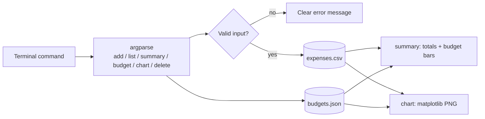

# 💰 Personal Expense Tracker with Charts

A Python command-line app for tracking what I spend. I can log an expense in one line, set monthly budgets per category, get warned when I'm close to or over a budget, and turn a month of spending into a three-chart visual report.

## 🎥 Demo Video
<!-- After uploading your video to YouTube (Unlisted), replace VIDEO_ID in both places below -->
[](https://www.youtube.com/watch?v=VIDEO_ID)

*A walkthrough with voice-over: adding expenses, checking budgets, and creating the chart report.*

## 1. Overview
As a college student in Chicago, I never knew where my money went each month until it was gone. Banking apps group everything their own way, so I built a tracker that uses **my** categories and **my** budgets and shows the result visually.

**Features**
- ➕ **Add an expense** in one command: `python3 expenses.py add 12.50 food "Chipotle"`
- 📋 **List** expenses by month or category
- 📊 **Summary** of totals per category, each one's share of the month, and a progress bar against its budget
- 🚨 **Budget alerts** the moment an expense goes past 80% or 100% of a budget
- 📈 **Chart report** with a category pie chart, stacked monthly totals, and cumulative spending vs. budget
- ✅ **Input checks:** rejects negative amounts, unknown categories and badly formatted dates


*The report created by `python3 expenses.py chart --month 2026-11`.*

## 2. How It Works


- **Storage:** expenses are saved in `expenses.csv` (id, date, amount, category, description), so they can be opened in Excel. Budgets are saved in `budgets.json`.
- **Commands:** `argparse` subcommands turn the program into a small CLI, and each command is its own function (`cmd_add`, `cmd_summary`, …).
- **Validation:** custom argparse "type" functions (`positive_amount`, `category_name`, `valid_date`) check input *before* anything is saved.
- **Charts:** `matplotlib` draws three charts side by side and saves them to `charts/report_YYYY-MM.png`.

**Tools:** Python 3, matplotlib, csv, json, argparse, Git & GitHub, VS Code


*The `summary` command shows that groceries went 73% over budget in October.*

## 3. Timeline
| Phase | What I did |
|---|---|
| 1. Plan | Picked my categories and decided what a "report" should answer: where did it go, is it more than last month, am I on track? |
| 2. Core | Built `add` and `list` with CSV storage |
| 3. Budgets | Added `budgets.json`, the `summary` table with progress bars, and the live alerts in `add` |
| 4. Charts | Built the three-chart report with matplotlib |
| 5. Polish | Added input validation, `delete`, and this README, then recorded the demo |

## 4. Challenges & Bugs Fixed
- **Typos created new categories.** Typing `Food` one day and `food` the next split my totals. Now categories are converted to lowercase and must come from a fixed list.
- **Bad amounts got saved.** `-5` or `$12,50` broke the totals. `positive_amount()` strips `$` and commas and rejects anything that's not more than 0.
- **The pie chart was unreadable.** Small categories like transport and bills had overlapping labels. I moved category names into a legend with dollar totals and only print percentages on slices of 5% or more.
- **Rent hid everything else.** Rent is so big that the "biggest expenses" list was always just rent, so the summary leaves rent out of that list.

## 5. What I Learned & Next Steps
I learned how to design a clean command-line interface, how to validate input at the edges, and how to choose the right chart for each question. Next I want to:
- import transactions straight from a bank's CSV export
- add recurring expenses (like rent) automatically each month
- build a simple web dashboard version

## ▶️ Run It Yourself
```bash
git clone https://github.com/ashah374/expense-tracker.git
cd expense-tracker
pip3 install -r requirements.txt
python3 expenses.py summary --month 2026-10
python3 expenses.py chart --month 2026-11 --open
python3 expenses.py --help
```
*`expenses.csv` comes with sample data so you can try it right away.*
