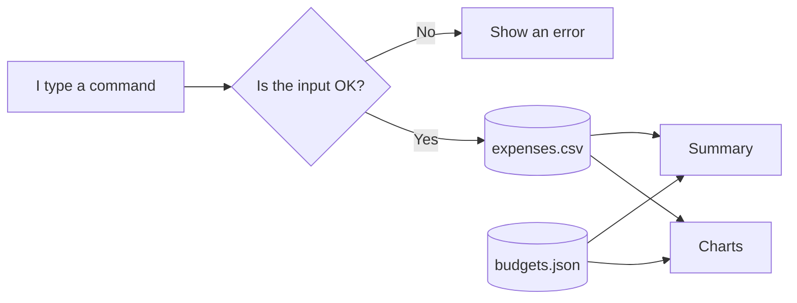

# Expense Tracker

A Python program I made that runs in the terminal. You type in what you spend, set a monthly budget for each category, and it shows where your money went, warns you when you go over budget, and makes charts of your spending.

## Demo Video

[](https://youtu.be/upLHSEuSh1k)

▶️ **[Watch my demo on YouTube](https://youtu.be/upLHSEuSh1k)**

In the video I show the monthly summary, add a new expense, try a wrong amount to show the error check, make the charts, and walk through part of the code.

## Why I made it

I wanted a simple way to see where money goes each month, and I wanted to practice Python with a project I could actually use and show.

## What it does

- **add** saves a new expense, e.g. `python3 expenses.py add 12.50 food "Chipotle"`
- **list** shows all expenses for a month
- **summary** shows the total for each category and how much of the budget is used
- **budget** sets a monthly budget, e.g. `python3 expenses.py budget food 250`
- **chart** makes a picture with 3 charts of the month
- It warns you when a category gets close to or goes over its budget
- It won't save wrong input, like a negative amount or a category that isn't on the list

The file `expenses.csv` has sample data for Sep–Nov 2026, so you can try it right away.


*The summary for October. Food, groceries, transport and entertainment went over budget.*

## How it works



- Expenses are saved in a CSV file, so you can also open them in Excel.
- Budgets are saved in a small JSON file.
- Each command is its own function in `expenses.py`.
- Before anything is saved, the program checks the amount, the category and the date.
- The charts are made with matplotlib and saved as a PNG file.


*The 3 charts: where the money went, totals for each month, and spending through the month compared to the budget.*

**Tools:** Python, matplotlib, Terminal, GitHub

## How I built it

I made this in November 2026 for my portfolio assignment, with help from an AI coding assistant. I ran it and tested it on my own Mac, fixed the problems I ran into, recorded the demo, and uploaded it here.

## Problems I ran into

- **Installing matplotlib didn't work at first.** My Mac gave an `externally-managed-environment` error. I fixed it by making a virtual environment and installing it there.
- **Terminal couldn't find my project.** The project was still a zip file on my Desktop. I had to unzip it and go into the right folder.
- **Typos in commands.** I typed `expeses.py` instead of `expenses.py` and got a "No such file" error. Small typos matter a lot in the terminal.

## What I'd add next

- Import spending straight from my bank's CSV file
- Add rent automatically every month
- Make a simple website version

## How to run it

```bash
git clone https://github.com/ashah374/expense-tracker.git
cd expense-tracker
python3 -m venv venv
source venv/bin/activate
pip install matplotlib
python3 expenses.py summary --month 2026-10
python3 expenses.py chart --month 2026-11 --open
```
